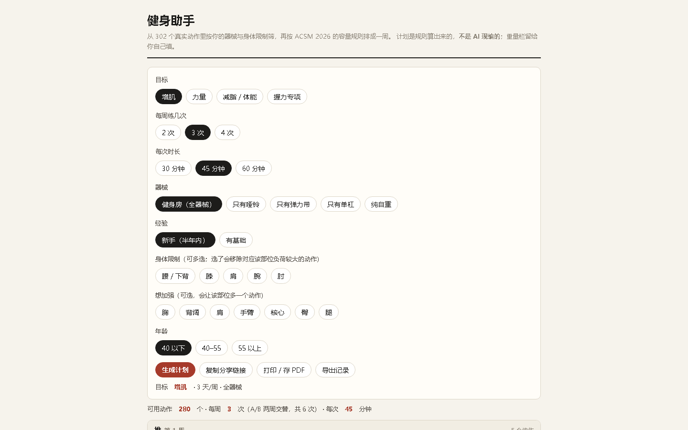

# 健身助手

输入目标、器械、身体限制 → 生成一周训练计划。**纯本地规则，不调任何 API。**

## 动作动画（assets/）

302 个动作的 SVG 逐帧动画（约 25 MB、900+ 文件）**不在仓库里**——它们是运行素材，不是代码，进仓库会把仓库撑到两位数 MB。获取方式：

1. 从 GitHub Release 下载 `fitness-assets-pack.zip`（约 10 MB）
2. 解压到仓库根的 `assets/` 目录，本地打开页面即得完整动画

没有这个目录页面照样能用：动画图加载失败会自动隐藏（`onerror` 降级），计划生成、记录、导出全不受影响。仓库本身只含 3 个文件（index.html / README.md / .nojekyll），远小于 3 MB。

## 用

打开页面 → 选条件 → 点「生成计划」。

- **复制分享链接**：参数编码在地址栏 `#` 后面，发给朋友打开就是同一份计划
- **记一笔**：每次练完填重量与次数，存在浏览器本地；下次自动显示"上次 60kg × 8"
- **导出记录**：把记录导成 txt
- **打印 / 存 PDF**：只打计划，不打输入区

## 规则不是 AI，是写死的

- 容量与负荷依据 **ACSM 2026 立场声明**（Currier BS 等，*Med Sci Sports Exerc* 2026;58(4):851-872）
  - 增肌：每肌群每周 ≥10 组为主指标，负荷 30–100% 1RM 等效，不练到力竭
  - 力量：≥80% 1RM，每动作 2–3 组，复合动作在前
- 身体限制用**两级标签**：高负荷的动作加 ⚠ 并后置；只"参与"的标「对选中部位有参与」，不删除
- 动作数据：Workout Guide（Bryl Lim），动作要领原始英文来自 free-exercise-db（公共领域，Unlicense）

## 已知限制

- 重量栏留空：工具不猜你的力量水平
- 膝部限制下，腿部动作几乎都会标 ⚠（腿动作天然压膝），这是事实，不是 bug
- 约 115 条动作要领来自"同类动作补写"，页面标了「未核对原版」
- 不提供医疗、康复、营养建议

## 反馈

卡住/看不懂/排得不对，带上你的选项（链接）说一句就行。